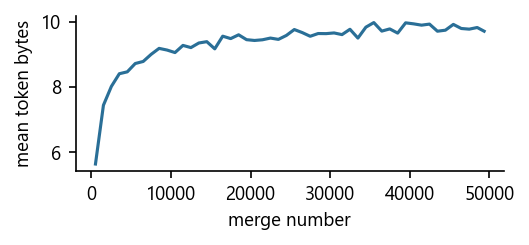
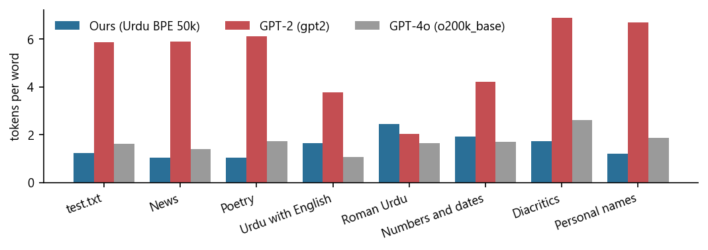

Faculty of Computing

CS 417: Large Language Models (LLMs)

Assignment-01

BSCS-13

LLM-Group-02

<table class="cover-table">
<tr><th>Name</th><th>Qalam ID</th></tr>
<tr><td>Rameen Arshad</td><td>461136</td></tr>
<tr><td>Laiba Riaz</td><td>464486</td></tr>
<tr><td>Adeena Reeham</td><td>480841</td></tr>
<tr><td>Zaynab Shahid</td><td>458224</td></tr>
</table>

Instructor: Prof. Dr. Naima Iltaf

# Building an Urdu BPE Tokenizer from Scratch

**CS 417 Large Language Models, Assignment 1.** LLM-Group-02: Rameen Arshad, Laiba Riaz, Adeena Reeham, Zaynab Shahid. October 2026.

## 1. Corpus and normalisation

We collected 57.05 MB ourselves through the MediaWiki API (Urdu Wikipedia, encyclopedia, and Urdu Wikisource, literature), downloaded the official Urdu Wikipedia XML dump of 1 October 2026 (skipping pages already collected through the API, and setting aside 434,745 articles under 1 KB, which are mostly bot-generated one-line stubs), and added the published UFAL UrMonoCorp (mixed web text from 2014, CC BY-NC-SA 3.0). After cleaning, the corpus is **1,210.14 MB, 339,466 documents and 147.83 million words** (1,420,018 distinct), split 98/1/1 by document with seed 1337, separately inside each source: train 1,185.94 MB, validation 11.93 MB, test 12.27 MB. UFAL is 58.9% of the bytes (94.0% before we added the dump) and Wikipedia 41.0%. UFAL's sentences are shuffled (neighbouring lines share 2.8% of their words, against 11.1% in Wikipedia dump articles and 9.9% in those from the API), so its documents are groups of 40 unrelated sentences. Cleaning took the raw 1,411.97 MB down to 1,210.14 MB, a net 201.83 MB (14.3%) after the document separators are added, mostly wiki markup and reference sections; every step and its effect are in DATA_CARD.md.

Urdu text mixes code points that look identical: Arabic yeh and alef maksura for Urdu yeh (603,854 found), Arabic kaf for Urdu kaf (113,402), Arabic heh for heh goal (133,637), plus tatweel, invisible marks and three digit sets. Our `normalize()` maps them to one form, keeps U+06BE apart from U+06C1, converts all digits to ASCII (99.9% already were), keeps diacritics (NFC, repeats collapsed) and keeps ZWNJ only between two joining letters, where Urdu uses it on purpose (3,963 of 7,271 kept; every one sits between two letters in the final files). On 100 MB of UFAL text it removes 5.6% of distinct words. The corpus is normalised once, before training; the tokenizer never calls `normalize`, so `decode(encode(x)) == x` holds for any string.

## 2. The tokenizer

**Specification.** IDs 0 to 255 are the bytes, 256 is `<|endoftext|>` (never split, never merged: training cuts the text at it), and the 49,743 merges take IDs 257 to 49,999 in the order learned. Ties go to the greater pair compared as byte strings, not as IDs (ID 257 = `ab` is smaller than ID 98 = `b`). Encoding applies merges in the order learned; decoding joins all bytes and decodes once, because one token can hold half a letter.

**Pre-tokenisation.** GPT-2's pattern uses `\p{L}+` for words. Urdu diacritics are combining marks (category M) and ZWNJ is a format character (Cf), so GPT-2 sends both to its punctuation branch: اُردُو becomes five pieces, `ا ُ رد ُ و`, and no merge can ever span a mark. In train.txt this would cut 1,389,662 Urdu word occurrences that carry a mark (0.99% of Urdu words), including the very common اُس, اُن and تعالیٰ. Our pattern:

{{include generated/b_pattern.md}}

The first alternative is a word: one optional space followed by a run of letters (`\p{L}`), combining marks (`\p{M}`) and ZWNJ, so اُردُو, تعالیٰ and بین‌الاقوامی each stay one piece and the space before a word joins it, as in GPT-2. Each digit (`\p{N}`) is its own piece, as in LLaMA, so a number is always cut the same way (1947 is never 194 + 7), at the cost measured in the table below; runs of other symbols also form their own pieces, with the same optional leading space; keeping them apart means ہے and ہے۔, or سال and سال1947, share one token instead of learning every glued variant. The last two alternatives take whitespace the GPT-2 way: a run of spaces gives up its final space to the next word, and newlines and tabs are never attached to a word; every character belongs to exactly one class, so the pieces always join back to the input.

{{include generated/ab_digits.md}}

**Training.** The reference trainer recounts every pair of every word occurrence after each merge, which costs about (merges x corpus size). The fast trainer (i) counts each distinct word once, weighted by its frequency: the 172,744,423 pre-tokens of train.txt collapse to 1,387,085 distinct ones; (ii) keeps an index from each pair to the words containing it, so a merge only touches those words: it subtracts their old pairs and adds their new ones; (iii) at encoding time, caches the IDs of every word already encoded, so almost every word is a dictionary lookup. The best pair comes from a binary heap with lazy deletion: when a count changes we push a new entry and skip any popped entry whose count is out of date. Python's `heapq` is a min-heap and bytes cannot be negated, so each entry is (−count, inv(bytes of a), inv(bytes of b), −a, −b), where inv maps every byte x to 255 − x and appends 256; this reverses byte-string order, prefixes included, so the smallest entry is the highest count with the greatest byte pair, and the IDs settle the rare tie between two different tokens with the same bytes (the reference trainer uses the same order).

{{include generated/b_training.md}}

Tests (`tests/`) check the hand-derived sanity corpus of Sennrich et al. (the handout's own example was missing from our copy), the byte-versus-ID tie-break, overlapping pairs (`aaa`), losslessness on emoji, English, mixed text, newlines, the empty string and 300 random Unicode strings, and that the fast trainer matches the reference on 200 random corpora and on the 1 MB sample.

## 3. What did the merges learn?

{{include generated/q1_summary.md}}

Merges 1 to 50 (merge *k* creates ID 256 + *k*; ␣ is a leading space; `letter`: rebuilds a two-byte letter; `space + letter`: adds a space to one; `partial`: not valid UTF-8 alone; `word`: a whole word; `N letters`: a longer piece):

{{include generated/q1_first50.md}}

Every 5,000th merge:

{{include generated/q1_every5000.md}}

The 20 longest tokens:

{{include generated/q1_longest.md}}

Every Urdu letter is two bytes and almost every word starts with a space, so the earliest merges rebuild letters and attach the space to the first byte of a word; those partial tokens are still used by encode wherever no longer merge applies. Later merges join letters into suffixes and frequent function words, then into whole words, and token length levels off near 10 bytes (about five letters) after 15,000 merges, where the remaining merges are mostly rarer words, names and word pieces. The longest tokens are long names and loanwords (انسائیکلوپیڈیا, خیبرپختونخوا), but also a cleaning artifact: several are words glued together, such as ٹیمکھیلےجیتےہارے ("team played won lost") and لیسٹرشائرکاؤنٹی ("Leicestershire County"). They come from the header rows of cricket tables in the Wikipedia dump, whose cells lost their separators when the wikitext was converted to plain text (mwparserfromhell's `strip_code` in `scripts/common.py`): the glued header occurs 221 times in train.txt against 77 times with spaces, and "Leicestershire County" 164 times glued against once spaced. Putting a space between table cells during that conversion would remove them.

## 4. How does it compare with existing tokenizers?

{{include generated/q2_test.md}}

Tokens per word on the seven hand-picked inputs (normalised as the corpus is):

{{include generated/q2_inputs.md}}

How the tokenizers cut a few words:

{{include generated/q2_splits.md}}

## 5. Three inputs our tokenizer handles badly

{{include generated/q3.md}}

All candidates we measured:

{{include generated/q3_all.md}}

**What normalisation is worth in tokens.** The cases of `normalization_cases.py`, raw and after `normalize()`, where our token count changes:

{{include generated/norm_tokens.md}}

**Choices and known limits.** English and Roman Urdu were left out of the corpus on purpose (only natural code-mixing was kept), so they cost more tokens than in o200k_base; if the next model must handle them, 2 to 5% of such text would fix it. Numbers also cost more than in o200k_base, because we split every digit (section 2). Text typed with Arabic letters or Urdu digits is costly only because it is unnormalised: in the next assignment we run `normalize()` before `encode()`, which keeps the tokenizer lossless and makes those inputs as cheap as normal Urdu. Some slots go to spelling variants that are both in use (امیرالمومنین 265 times and امیرالمؤمنین 159 in train.txt, both tokens), which we did not force together because both spellings are correct, and a few to junk such as laughter (ہاہاہا, 2,105 times). Adding the October 2026 Wikipedia dump took UFAL from 94% to 59% of train.txt: two junk tokens of our first vocabulary (a seven-syllable laughter and the footer میرےدیگرمضامین, "my other articles", with its spaces missing) dropped out, tokens per word fell 1.9% on the Wikipedia part of test.txt and 6% on our diacritics input, and rose only 0.5% on the UFAL part. The vocabulary still holds 2014 topics (طالبانائزیشن), and recent news and conversational Urdu remain the largest gap.

## 6. Code and data

- **Code and saved tokenizer:** [https://github.com/reeham4411/Urdu-BPE-Tokenizer](https://github.com/reeham4411/Urdu-BPE-Tokenizer)
- **Data (train/val/test.txt, train.bin, val.bin):** [https://drive.google.com/drive/folders/15mM4_TXFahkNFSQh1qgycO18gAWOkmXo](https://drive.google.com/drive/folders/15mM4_TXFahkNFSQh1qgycO18gAWOkmXo)
